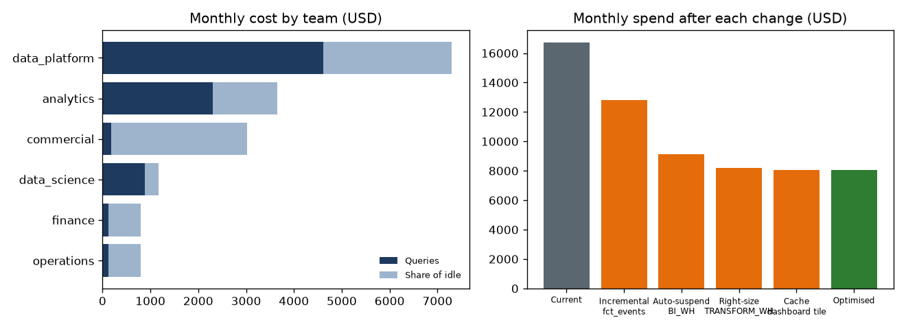
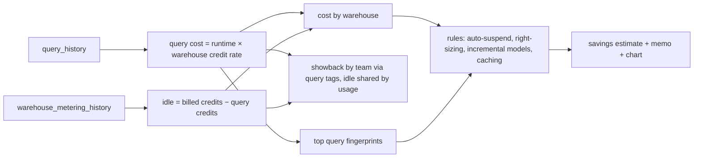

# Warehouse FinOps

[](https://github.com/Saigwe/warehouse-finops/actions/workflows/ci.yml)
 

> **Headline:** four changes, under a week of engineering effort, cut warehouse spend by **52% ($104k a year)** with no loss of service.

A cloud data warehouse cost review of the kind finance and data leaders ask for: where the money goes (by warehouse, team and query pattern), how much of it is waste, and which fixes pay back fastest. The input is 30 days of usage data shaped like Snowflake's `ACCOUNT_USAGE` views (query history, warehouse metering), with four realistic kinds of waste planted in it.



## What it finds

| Change | Saving / year | Effort | Why |
|---|---|---|---|
| Make `fct_events` incremental | $47,049 | 2 days | Rebuilt 24 times a day, scanning 400 GB each time |
| Shorten auto-suspend on `BI_WH` | $44,392 | 5 minutes | 94% of its bill is idle time with a 60-minute auto-suspend |
| Right-size `TRANSFORM_WH` | $11,055 | 1 day | Light models (p90 under 1 GB) running on an X-Large warehouse |
| Cache the executive revenue tile | $1,596 | half a day | Identical query 132 times a day on hourly data |

The outputs are written for different audiences:
- **[`output/executive_memo.md`](output/executive_memo.md):** a one-page decision memo for the CFO or CDO, with the bottom line, the four fixes and a recommendation.
- **[`output/report.md`](output/report.md):** the full analysis for the data team.

## How it works



- **Attribution reconciles to the bill.** Work plus idle equals billed for every warehouse, and the team showback sums to the total. Both are tested.
- **Showback, not just totals.** `query_tag` JSON carries team and model, so each team sees its own cost, including a fair share of idle time.
- **Conservative savings.** Right-sizing assumes queries run 20% slower on the smaller warehouse; incremental builds assume 15% of the full-refresh cost remains.

## Run it

```bash
pip install -r requirements.txt
python -m finops.analyze      # generates data, writes output/report.md, executive_memo.md, cost_savings.png
pytest
```

To use real data, export `SNOWFLAKE.ACCOUNT_USAGE.QUERY_HISTORY` and `WAREHOUSE_METERING_HISTORY` into `data/` with the same columns.

## Stack

SQL (DuckDB, window functions, JSON extraction), Python, matplotlib, pytest.
