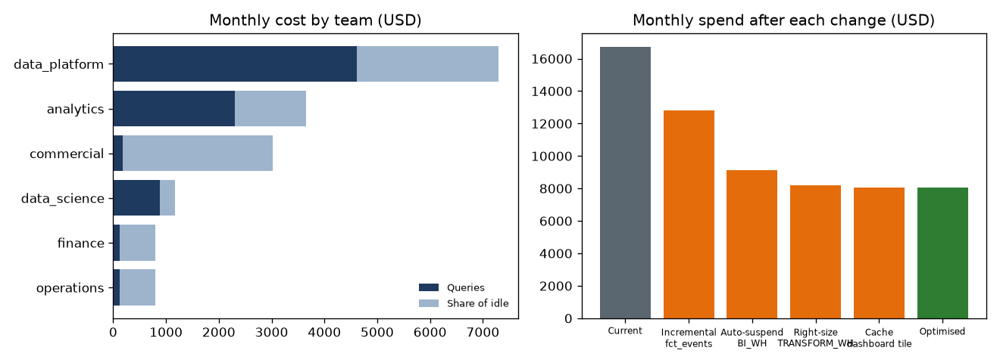

# Warehouse cost review (30 days)

Total billed: **$16,744** ($3/credit).

## By warehouse

| warehouse_name | size | auto_suspend_s | billed_usd | work_usd | idle_usd | idle_pct |
|---|---|---|---|---|---|---|
| TRANSFORM_WH | XLARGE | 60 | 10,947.86 | 6,915.86 | 4,032.00 | 36.80 |
| BI_WH | MEDIUM | 3600 | 4,380.00 | 269.60 | 4,110.40 | 93.80 |
| DS_WH | LARGE | 300 | 1,173.25 | 877.78 | 295.47 | 25.20 |
| ADHOC_WH | SMALL | 60 | 243.24 | 175.84 | 67.40 | 27.70 |

## By team (showback)

| team | query_usd | shared_idle_usd | total_usd |
|---|---|---|---|
| data_platform | 4,612.69 | 2,689.24 | 7,301.93 |
| analytics | 2,303.16 | 1,342.76 | 3,645.93 |
| commercial | 186.32 | 2,840.69 | 3,027.01 |
| data_science | 877.78 | 295.47 | 1,173.25 |
| finance | 128.84 | 671.23 | 800.07 |
| operations | 130.29 | 665.88 | 796.16 |

## Most expensive query patterns

| query_fingerprint | warehouse_name | model | runs | active_days | avg_seconds | avg_gb_scanned | cost_usd |
|---|---|---|---|---|---|---|---|
| fp_fct_events_full_refresh | TRANSFORM_WH | fct_events | 720 | 30 | 480.50 | 399.76 | 4,612.69 |
| fp_stg_model_11 | TRANSFORM_WH | stg_model_11 | 360 | 30 | 40.60 | 0.32 | 194.97 |
| fp_stg_model_3 | TRANSFORM_WH | stg_model_3 | 360 | 30 | 40.60 | 0.32 | 194.64 |
| fp_stg_model_10 | TRANSFORM_WH | stg_model_10 | 360 | 30 | 40.40 | 0.32 | 193.86 |
| fp_stg_model_6 | TRANSFORM_WH | stg_model_6 | 360 | 30 | 40.40 | 0.32 | 193.69 |
| fp_stg_model_8 | TRANSFORM_WH | stg_model_8 | 360 | 30 | 40.20 | 0.33 | 192.95 |
| fp_stg_model_5 | TRANSFORM_WH | stg_model_5 | 360 | 30 | 40.10 | 0.31 | 192.71 |
| fp_stg_model_4 | TRANSFORM_WH | stg_model_4 | 360 | 30 | 40.00 | 0.33 | 191.79 |
| fp_stg_model_2 | TRANSFORM_WH | stg_model_2 | 360 | 30 | 39.70 | 0.32 | 190.61 |
| fp_stg_model_0 | TRANSFORM_WH | stg_model_0 | 360 | 30 | 39.70 | 0.32 | 190.51 |

## Recommendations

| change | monthly_usd | annual_usd | effort |
|---|---|---|---|
| Make fct_events incremental | 3,920.79 | 47,049.48 | 2 days |
| Shorten auto-suspend on BI_WH | 3,699.36 | 44,392.32 | 5 minutes |
| Right-size TRANSFORM_WH for light models | 921.27 | 11,055.24 | 1 day |
| Cache the exec_revenue_tile query | 133.04 | 1,596.48 | half a day |

